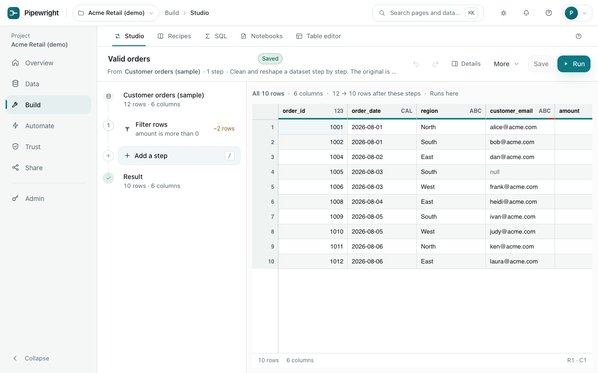

# Build

Clean and reshape data, step by step, seeing the result as you go.

## Studio

Pick a dataset and add steps. Your original data is never changed: the Studio shows what the steps would make, and saving keeps the steps as a recipe.

- **Add a step** (or press `/`) searches the common steps and the tool library: filter rows, fix text, split a column, join another dataset and more.
- **Right-click a column** for the steps that suit it, such as "Standardise an email" on an email column.
- **Click a step** to change its settings right under it. Each step says in a few words what it does.
- **Undo** and **redo** take any change back. Clicking a column header only sorts what is on screen; it does not add a step.

- Unsaved work on a new recipe is kept in your browser and offered back next time.
- **Details** shows the columns, where each step runs (at the source or here), the recipe as a file, and comments.

### Editing together

Everyone who opens a saved recipe in the Studio edits the same copy of it. What someone else changes appears in your Studio within a couple of seconds, without reloading, and nobody's work is written over: two people can change different steps, or different settings of one step, at once. If two people change the same setting at the same moment, the later change is kept.

- The people with the recipe open show at the top, and each person's initials sit on the step they have open.
- **Undo** takes back only your own changes, and leaves alone anything someone else has changed since.
- Unsaved changes stay in the shared copy, for everyone, until someone saves them or chooses **More → Discard unsaved changes**.
- If someone changes the recipe outside the Studio (restores an older version, or accepts a suggestion), your Studio says so and shows the saved recipe; anything you had not saved is offered back.
- A save that started from an older version than the saved one is refused, saying who saved since and when, rather than replacing their changes.

### Suggesting a change

Someone who may look at a recipe but not change it (a viewer or an operator), or anyone in a project whose changes need approval, sees **Suggest** where Save would be. Change the steps as you would, then **Suggest**: give it a title and a reason, and it goes to the people who may edit the recipe. They see "1 suggestion waiting" in the Studio and under [Approvals](trust.md#approvals), compare it step by step, and accept it (it becomes the recipe's next version) or decline it with a note. You hear which.

**Start from a template** offers recipes for common jobs, such as tidying a customer list, matched to your columns.

When it looks right, **Save**, then **Run** to make the result a dataset. Run it again any time, or put it on a [schedule](automate.md#schedules).

## Recipes

Every saved recipe. Open one to change its steps in the Studio, or run it to make a fresh result. Each run adds a version to the same result dataset.

## SQL

Write SQL against a connected database and see the results. It only reads unless an administrator allows writing; a statement that would change data asks you to confirm first. Save the queries you use often. You can also ask a dataset version a question in SQL from its version history.

## Notebooks

Mix SQL, recipe and text cells that run top to bottom; each cell can use the results of the cells above it. Python cells run only on servers where they can be kept within safe limits, and the page says when they are off.

## Table editor

Change rows in a connected database table directly. You see every change, and how many rows it affects, before anything is saved, and a change that would touch rows someone else just changed is stopped. Only tables with a clear way to identify each row can be edited.
