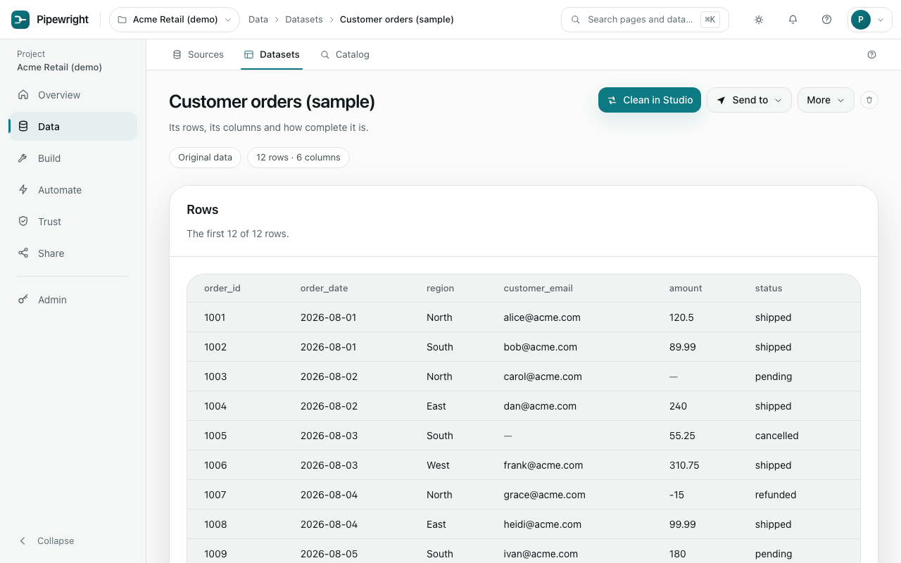

# Data

Where tables arrive: uploaded files, databases, apps, APIs, storage and live feeds.

## Sources

### Upload a file

Choose **Upload a file**. Spreadsheets, delimited text, JSON, XML, Parquet and more are read, plain or compressed. Before anything is saved, Pipewright shows how it will read the file: the columns, their kinds and a preview. If a date could be read two ways, it asks rather than guessing.

Large files upload in parts, so a dropped connection resumes rather than starts over.

### Connect a source

Choose **Connect a source** and pick from the catalogue: databases, apps such as GitHub or HubSpot, APIs and storage buckets. Each shows how well it is tested:

- **Tested** connectors run against a real server in every build.
- **Available on request** connectors are written from the vendor's documentation and have not yet been run against a real account. They usually work; tell your administrator if one does not, and it can be validated with you.

Keys and passwords are encrypted when saved and never shown again.

### Import from a source

On a connection, choose **See what it holds** (or **Browse tables** for a database), pick a table or a stream, preview it, and import it. An import can:

- replace everything each time,
- add only new rows, using a column that only goes up, such as an update time, or
- update matching rows, using the columns that identify a row.

Each run of an import adds a version to the same dataset, so you keep one dataset with a history rather than a new one per run.

### Live feeds

A live feed receives events sent to a web address, or follows the changes in a PostgreSQL table. Following changes needs your database administrator to turn on change tracking; the first check says if it is off.

## Datasets

Every table in the project, one row per name. Filter by where it came from (uploaded, imported, made by a recipe) or find one by name.

On a dataset's page:

- **Rows** shows a preview, and **Columns** shows each column's kind, how often it is empty and how varied it is.
- **Clean in Studio** opens it in the [Studio](build.md#studio).
- **Send to** delivers it to a [destination](automate.md#destinations), Power BI or Tableau, or downloads it as CSV or Parquet.
- **Version history** lists every saved version. Open, query, compare or restore any of them; restoring adds a new version, so nothing is lost.

If a [policy](trust.md#policies) limits what your role can see, the page says so, and the same limit applies in charts, downloads and everywhere else.

## Catalog

Search datasets by name, by column or by what someone wrote about them. Mark owners and certify datasets that others can rely on, and keep a glossary so a word like "active customer" means one thing.
