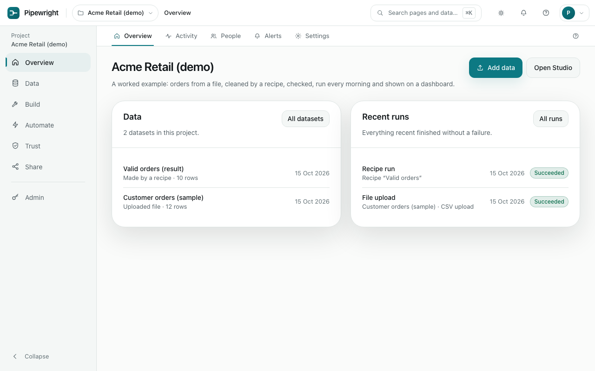
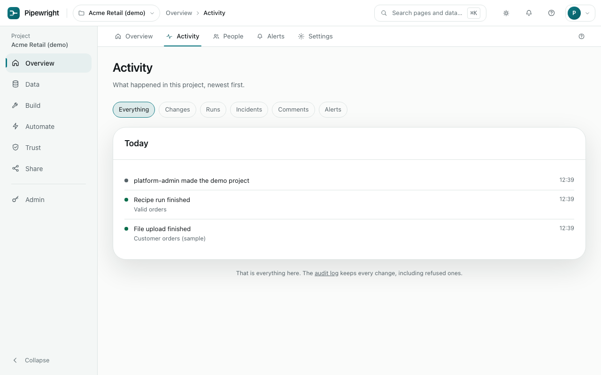

# Overview

A project's front page: what to do next, the newest data and the latest runs.

## Overview

The checklist shows the five steps that get a project working (add data, clean it, check it, automate it, share it) and ticks each one as you finish it. Below it are the newest datasets and the last few runs. **Add data** is always here.

## Activity

Everything that happened in the project, newest first, in one list: changes people made, runs that finished or failed, incidents that opened or were resolved, comments, and alerts on measures. Each line says who and when, and links to what it is about. Choose a kind to see only that. The list goes back 2,000 items; the [audit log](trust.md#audit-log) keeps every change, including attempts that were refused.

## People

Add people who already have an account and choose what each can do. See [roles](glossary.md#roles). Removing someone takes away their access to this project only; their account and their other projects are untouched.

To invite someone who has no account yet, ask a platform administrator to create one under Admin, Accounts.

## Alerts

Everything already appears in the bell at the top of the page. **Add a channel** sends it to other places too: an email address, a Slack channel, or a webhook that sends each event as signed JSON to your own systems ([how to receive one](api.md#webhooks)). For each channel, choose what it hears about:

- a scheduled run, a recipe run or a delivery that failed or finished
- an incident that opened
- a workflow that failed or finished with problems
- a measure that crossed its alert, or came back ([alerts on measures](trust.md#data-health-and-alerts))
- a weekly summary of the project

Use **Send a test** to check one works before relying on it. A failure to send never affects the run itself. A webhook shows its **Deliveries**, every try and its result.

## Settings

Rename the project, describe what it is for, archive it when it is no longer used (it stays readable), or delete it with everything in it.

**Move this project's work** downloads a bundle: one file with the project's recipes, checks, metrics, charts, dashboards, workflows and schedules, but none of its data or passwords. **Import a bundle** in another project, here or on another Pipewright, shows first what will be made and what will be left out and why. Things are matched by name: the datasets, imports and destinations the bundle uses must already exist in the project, or you choose stand-ins for them. Anything whose name the project already uses is left as it is.
