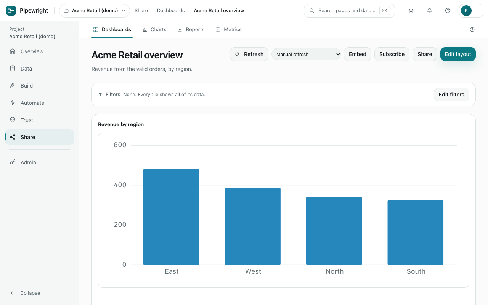

# Share

Turn data into charts, dashboards and reports people can read.

## Dashboards

A dashboard is a page of charts that answer one question together, with headings and notes between them. Filters at the top apply to every chart on it. **Share** gives a link that works without signing in; turn it off at any time and the link stops working at once. **Embed** shows the dashboard inside another site, such as a customer portal, with a link that runs out after a day, a week, a month or a year; [embedding a dashboard](api.md#embedding-a-dashboard) explains how a site shows each customer only their own rows. An embed link opens on its own too, for a share link that runs out. **Subscribe** emails the dashboard to you on a schedule.

## Charts

Pick a dataset, what to group by and what to add up; the preview updates as you change it. Bar, line, area, pie, scatter, a single number (with its change from the last period) and a table are available. Save a chart, then put it on a dashboard.

## Reports

A report sends a dataset, chart or dashboard as a file (Excel, CSV, PDF or a web page) by email or Slack on a timetable. Each report keeps a history of what was sent and whether it arrived.

## Metrics

Define an important number once, such as net revenue: what it adds up, its filters and how it may be split. Charts and reports built on a metric always agree, and changing a definition keeps the old ones.
