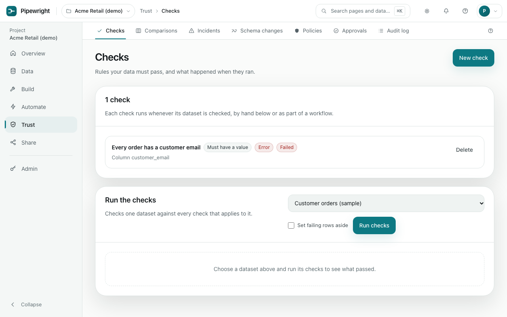
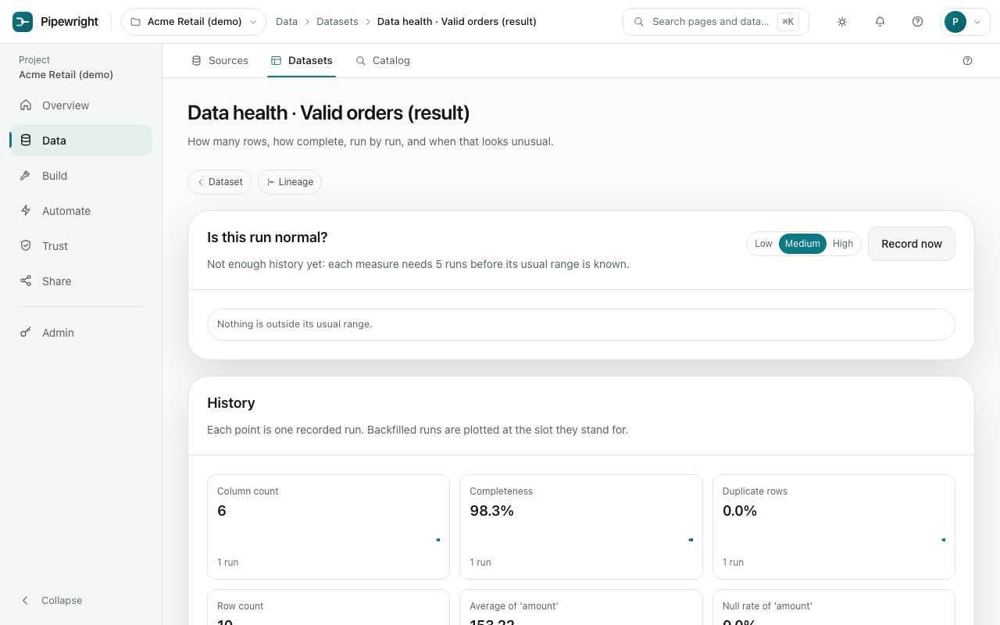
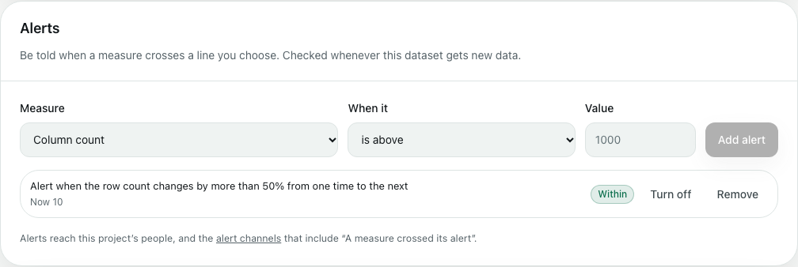

# Trust

Know the data is right, and hear about it when it is not.

## Checks

A check is a rule the data must pass, such as "every order has an email" or "amount is between 0 and 10,000". Add checks to a dataset, then run them yourself, or as a task in a workflow, which can run on a timetable. Each run shows how many rows failed each check.

Turn on **quarantine** and failing rows are set aside in their own dataset while the good rows carry on. A check that must pass and fails in a workflow opens an [incident](#incidents) and stops the tasks after it; one you run yourself shows its result on the page.

## Data health and alerts

Every time a dataset gets new data (an upload, an import, a recipe run, a workflow or a rollback), its measures are recorded: the row count, completeness, duplicate rows, and each column's null rate, distinct values and average. **Data health**, from the dataset page, charts them run by run and flags any far from their usual range.

An **alert** draws a line a measure should not cross: the row count above or below a number, a column's null rate above a share, or any measure changing by more than a share since the last time. It is checked each time the measures are recorded. It tells you once when the measure crosses its line, and again when it comes back, not on every run in between. Alerts reach the project's people in the bell, and any [alert channel](overview.md#alerts) that asks to hear "A measure crossed its alert". An alert made past its line says so at once.

## Comparisons

Save a statistical comparison between two datasets, such as "the average order is the same as last month", and run it again after the data changes. A comparison shows whether a difference is beyond chance, not why it happened.

## Incidents

An incident is a problem that needs a person: a failed check, data that has not arrived, a number far from its usual range, or a background worker that stopped. Everyone who can act on it is told, in the app and on the project's alert channels.

**Acknowledge** an incident to show someone is on it, **assign** it to a person, and **resolve** it when fixed. Many incidents close by themselves when the problem clears. A problem that keeps happening counts up on one incident rather than opening a new one each time.

## Schema changes

Columns added, removed or retyped at a source since its last import. Breaking changes are marked, because they can stop recipes working. Acknowledge a change once you have dealt with it.

## Contracts

A **contract** is a promise about a dataset, written down so the people who use it can rely on it: which columns it has and what is in them, how many rows, and how often it gets new data. Open it from the dataset page (**More → Write a contract**) or **Trust → Contracts**. It starts from the data as it is now, every column with its kind and "always filled" where nothing is empty, for you to change before saving.

Each column can promise its kind (text, whole number, decimal number, date, date & time, true / false), that it is always filled, that no value repeats, that its values come from a list, or that its numbers stay between a lowest and highest. The dataset as a whole can promise at least or at most so many rows, no more than a share fewer rows than before, new data at least every so many hours (the same promise **Data health** shows as freshness), and whether new columns may appear.

A contract is checked where data lands: every recipe run, import and stream save, before the new data is stored. Set to **stop** (the default), data that breaks it is not saved: the run fails with the reasons, and the current data stays as it was. Set to **warn**, the data is saved and the problem recorded. The Studio says when a recipe's result no longer has a promised column, before you run it, and restoring an older version that breaks a contract set to stop is refused, with the reasons shown first. Erasing a person's data is never stopped; a promise it breaks is recorded.

A problem is recorded once while it lasts ("seen 3 times"), and resolves itself when new data from the same place keeps the contract. **Follow** a contract to be told when it breaks, when it is kept again and when its promises change; its owner is always told, and so is any [alert channel](overview.md#alerts) that asks for "A contract was broken or changed". The contract lists what relies on the dataset (recipes, checks, charts, dashboards, metrics, scheduled deliveries and workflows), and dropping a promise shows what reads that column before you save. Every change is a new version with what changed, in words.

## Policies

Policies decide who sees what:

- **Row rules** hide rows from a role, such as "viewers see only the EU".
- **Column rules** hide a column from a role, or mask it: partly hidden (`an***@example.com`), replaced with `[redacted]`, or turned into a code that still groups and joins.

A policy applies wherever rows reach a person: the dataset page, charts and dashboards (public links read as a viewer), the Studio, SQL over a version, the assistant, comparisons, downloads and deliveries. Column names still appear in lineage and recipes, which describe the shape of the data, not its values. **Policy simulation** shows exactly what a role or one person would see before you grant it.

Policies also set **retention** (how long old runs, history and versions are kept) and handle **erasure**: correcting or removing one person's data everywhere it appears, with a report of anything that could not be done.

## Approvals

Suggested changes wait here for someone to accept or decline them: a [recipe change someone suggested](build.md#suggesting-a-change), or any change in a project whose changes need approval (an admin switches that on under [Settings](overview.md#settings)). A recipe's change is shown step by step. Nobody can accept their own; the person who suggested it hears what became of it. Running things is never blocked; only changing what they are.

## Audit log

Who changed what in the project, and when, in plain sentences: "Ann ran a recipe", "Bo deleted the dashboard Weekly sales". Refused attempts are recorded too. Looking at things is not recorded; changing them is.
